# GlobalGroupTravel-CRM — Documentation Technique

> Projet Salesforce DX pour GlobalGroupTravel, fournisseur de voyages de groupe à l'international et pour entreprises. Ce document couvre le modèle de données, le modèle de sécurité, les règles métier GGT-01 à GGT-05, la stratégie de tests et les limites connues.

---

## 1. Introduction

GlobalGroupTravel est un fournisseur de voyages de groupe (écoles, associations sportives, entreprises) qui a besoin d'un CRM Salesforce pour :

- suivre son cycle de vente (Account → Opportunity → Contract) ;
- automatiser la création d'un dossier voyage (`Trip__c`) dès qu'une vente est conclue ;
- garantir la cohérence des dates de voyage ;
- annuler automatiquement les voyages qui n'atteignent pas un seuil minimum de participants à l'approche du départ ;
- refléter automatiquement le statut réel de chaque voyage (à venir / en cours / terminé) sans intervention manuelle.

Ce projet livre l'architecture de données, la sécurité et les automatisations Apex répondant à ces besoins, sur une org Salesforce Developer Edition, sans dépendance à Salesforce Shield (non disponible sur Developer Edition gratuite).

---

## 2. Schéma du modèle de données

### 2.1 Diagramme ERD

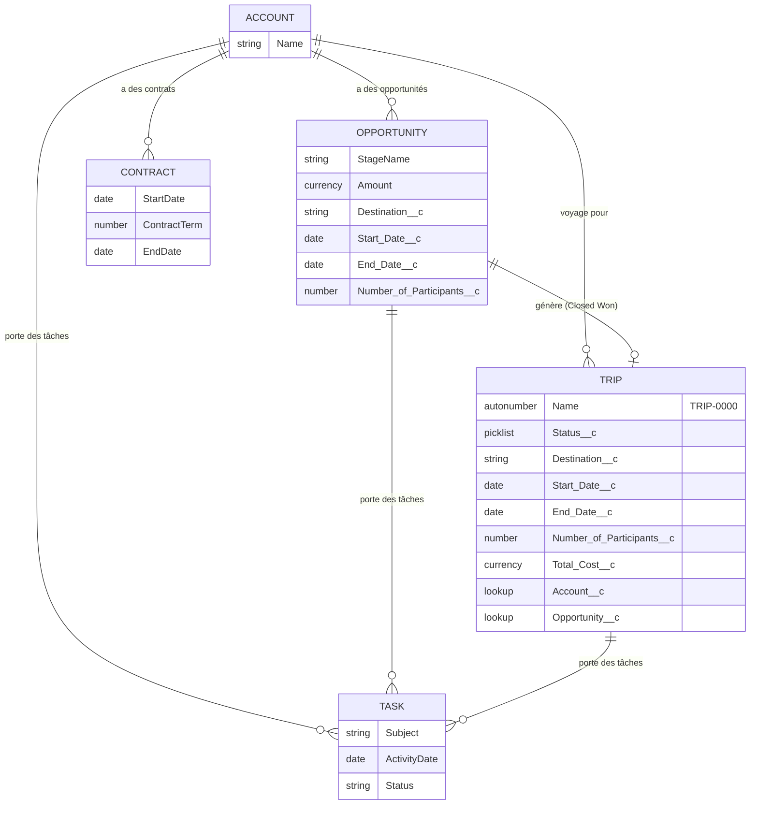


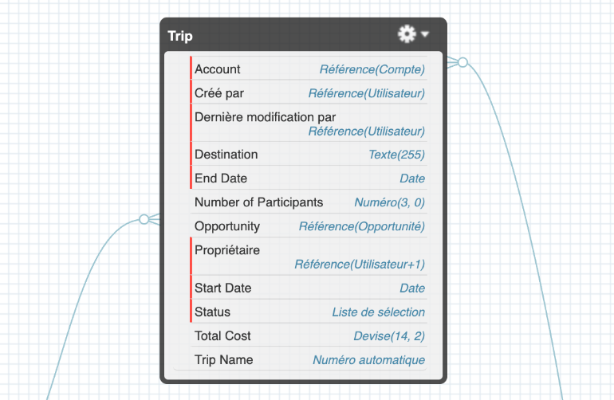

*Figure 1 — Générateur de schéma Salesforce : l'objet personnalisé Trip__c, ses champs et ses relations vers Account (Compte) et Opportunity (Opportunité).*

### 2.2 Détail des champs custom

**`Trip__c`** (sharing model : Private)

| Champ (Label) | API Name | Type | Détails |
|---|---|---|---|
| Trip Name | `Name` | Auto Number | Format `TRIP-{0000}`, démarre à 1 |
| Status | `Status__c` | Picklist | `À venir` (défaut), `En cours`, `Terminé`, `Annulé` |
| Destination | `Destination__c` | Text(255) | Obligatoire |
| Start Date | `Start_Date__c` | Date | Obligatoire |
| End Date | `End_Date__c` | Date | Obligatoire |
| Number of Participants | `Number_of_Participants__c` | Number(3,0) | Optionnel — peut être vide (GGT-04 exclut explicitement les valeurs vides) |
| Total Cost | `Total_Cost__c` | Currency(16,2) | Champ éditable classique, alimenté depuis `Opportunity.Amount` à la création |
| Account | `Account__c` | Lookup(Account) | Obligatoire |
| Opportunity | `Opportunity__c` | Lookup(Opportunity) | Optionnel (un Trip peut être créé manuellement) |


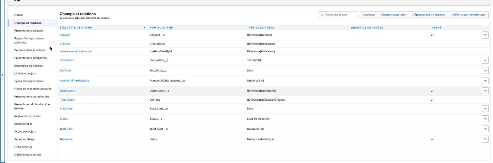

*Figure 2 — Gestionnaire d'objet : les 12 champs de Trip__c (8 champs métier + champs système).*

**`Opportunity`** — champs custom ajoutés (GGT-01)

| Champ (Label) | API Name | Type |
|---|---|---|
| Number of Participants | `Number_of_Participants__c` | Number(3,0) |
| Destination | `Destination__c` | Text(255) |
| Start Date | `Start_Date__c` | Date |
| End Date | `End_Date__c` | Date |

**`Trip_Settings__mdt`** (Custom Metadata Type)

| Champ | API Name | Type | Valeur (`Default`) |
|---|---|---|---|
| Min Participants | `Min_Participants__c` | Number | 10 |
| Days Before Departure | `Days_Before_Departure__c` | Number | 7 |

### 2.3 Validation Rules déclaratives

| Objet | Nom | Règle |
|---|---|---|
| `Trip__c` | `Trip_Participants_Positive` | Bloque si `Number_of_Participants__c` est renseigné ET `≤ 0` |
| `Opportunity` | `Opportunity_Amount_Not_Negative` | Bloque si `Amount < 0` |

La cohérence des dates de `Trip__c` (GGT-03) est volontairement **exclue** des Validation Rules déclaratives et implémentée en Apex (trigger), conformément au cahier des charges.

### 2.4 Autres objets

- **Account** : champs standards suffisants.
- **Contract** : champs standards (`StartDate`, `ContractTerm`, `EndDate` calculé), aucune automatisation.
- **Task** : liée via `WhatId` à Account / Opportunity / Trip__c.
- **User** : aucun objet custom ; gestion des commerciaux via Profils + Permission Set sur les Users existants.

---

## 3. Modèle de sécurité

### 3.1 Org-Wide Defaults (OWD)

| Objet | OWD déployé |
|---|---|
| `Account` | Private |
| `Contract` | Private |
| `Trip__c` | Private |
| `Task` | Controlled by Parent |
| `Opportunity` | **Private** (voir écart documenté ci-dessous) |
| `Case` | Private (effet de bord, voir ci-dessous) |


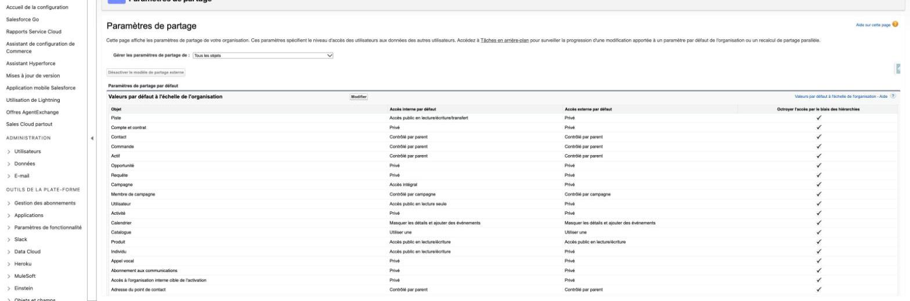

*Figure 3 — Paramètres de partage : Compte et contrat, et Opportunité, en accès par défaut Privé.*

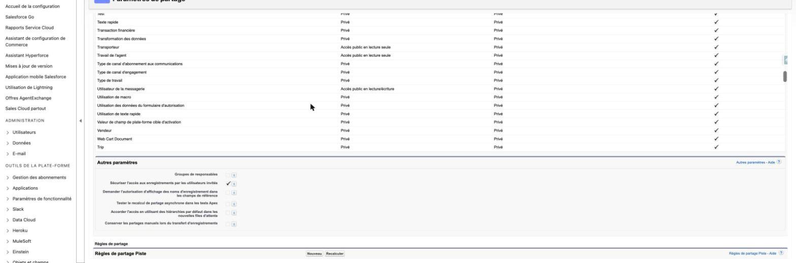

*Figure 4 — Paramètres de partage : l'objet Trip en accès par défaut Privé.*

**Écart par rapport au cahier des charges — Opportunity OWD** : les notes de cadrage demandaient `Opportunity : Controlled by Parent`. L'API Metadata Salesforce **rejette explicitement** cette valeur pour l'objet Opportunity (`ControlledByParent is not a valid sharing model for Opportunity`), bien que l'interface Setup l'autorise dans certains contextes. `Opportunity` a donc été déployé en **Private**. Conséquence : un Manager ne voit pas automatiquement les Opportunity de ses commerciaux via la seule hiérarchie de rôles ; seuls Account, Contract et Trip__c en bénéficient pleinement. Piste d'évolution : ajouter une Sharing Rule basée sur les rôles si ce besoin se confirme.

**Effet de bord — Case** : passer `Account` à Private a forcé Salesforce à revalider le sharing model de `Case` (objet standard non demandé dans ce projet), dont la valeur par défaut (`ReadWriteTransfer`) devenait incompatible. `Case` a donc été mis à `Private` pour permettre le déploiement, sans conséquence fonctionnelle puisque `Case` n'est pas utilisé dans ce projet.

### 3.2 Rôles hiérarchiques

Une hiérarchie à 2 niveaux a été créée, conformément à l'exigence d'utiliser rôles **et** profils :

```
Manager Commercial GlobalGroupTravel
        └── Commercial GlobalGroupTravel
```

Avec un OWD Private sur `Account`/`Contract`/`Trip__c`, cette hiérarchie permet à un Manager de voir automatiquement les enregistrements de ses commerciaux subordonnés, sans élargir la Sharing Rule ci-dessous — les deux mécanismes sont complémentaires, pas redondants.


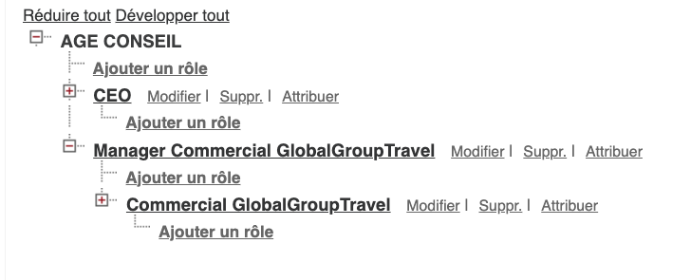

*Figure 5 — Hiérarchie des rôles : Manager Commercial GlobalGroupTravel, parent de Commercial GlobalGroupTravel.*

### 3.3 Permission Set `Commercial_GlobalGroupTravel`

CRUD complet sur `Account`, `Opportunity`, `Contract`, `Task`, `Trip__c`. FLS restreinte : `Trip__c.Total_Cost__c` en **lecture seule** (le montant total du voyage n'est éditable que par un administrateur).

> Note technique : les champs marqués `required=true` (ex. `Trip__c.Destination__c`, `Start_Date__c`, `End_Date__c`, `Account__c`, `Status__c`) sont toujours pleinement accessibles côté plateforme Salesforce et ne peuvent pas recevoir d'entrée FLS explicite — seuls les champs optionnels apparaissent dans le Permission Set.


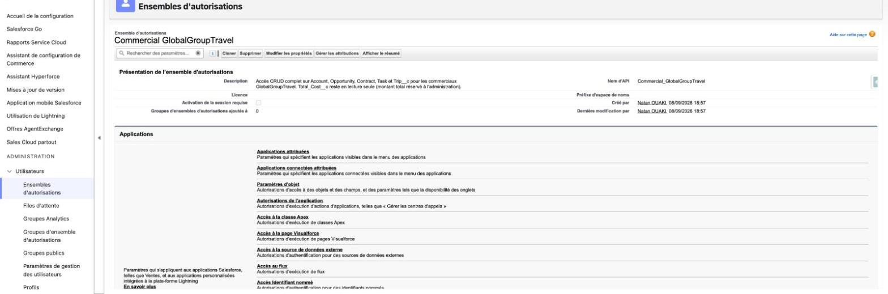

*Figure 6 — Ensemble d'autorisations Commercial_GlobalGroupTravel : CRUD sur les objets métier, Total_Cost__c en lecture seule.*

### 3.4 Sharing Rule

Une Criteria-Based Sharing Rule sur `Trip__c` partage en lecture seule les enregistrements `Status__c = 'Annulé'` avec le Public Group `Managers_GlobalGroupTravel` (groupe vide à la livraison, alimenté par l'équipe GlobalGroupTravel).


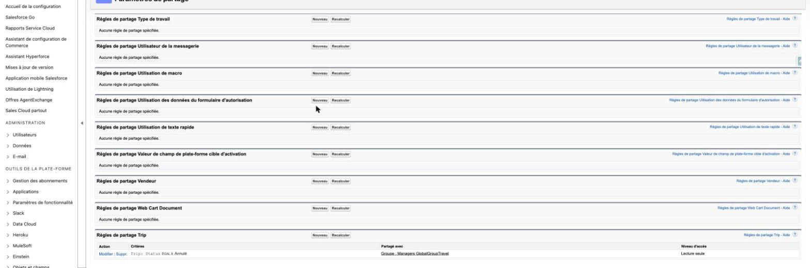

*Figure 7 — Règle de partage sur Trip : les voyages au statut Annulé sont partagés en lecture seule avec le groupe Managers GlobalGroupTravel.*

### 3.5 Enforcement dans le code

Toutes les classes Selector et Service sont déclarées `with sharing`. Toute opération DML issue de données manipulées par le code applique `Security.stripInaccessible(AccessType.CREATABLE/UPDATABLE/READABLE, records)` avant écriture ou lecture, garantissant le respect du CRUD/FLS de l'utilisateur courant même en dehors du contexte déclaratif.

**Comportement à connaître : FLS des champs personnalisés** : à la création d'un champ personnalisé (par la CLI ou par un déploiement), les accès en lecture et en écriture sont à *faux* par défaut pour **tous** les profils, y compris le profil Administrateur Système. Il faut donc déclarer explicitement la FLS dans un Profile ou un Permission Set. Ici, `force-app/main/default/profiles/Admin.profile-meta.xml` accorde la FLS sur les champs optionnels utilisés avec `Security.stripInaccessible` (`Trip__c.Number_of_Participants__c`, `Trip__c.Total_Cost__c`, `Trip__c.Opportunity__c` et les 4 champs personnalisés d'`Opportunity`), et le Permission Set `Commercial_GlobalGroupTravel` l'accorde aux commerciaux. À garder en tête pour tout nouveau champ.

### 3.6 Non-utilisation de Salesforce Shield

Ce projet est développé sur une org Developer Edition gratuite, sur laquelle Salesforce Shield (Platform Encryption, Event Monitoring, Field Audit Trail) n'est pas disponible. La sécurité repose donc entièrement sur les mécanismes natifs et gratuits de la plateforme : OWD, rôles, Permission Set, Sharing Rule, FLS et enforcement applicatif (`with sharing` + `Security.stripInaccessible`).

---

## 4. Liste des fonctionnalités (GGT-01 à GGT-05)

### GGT-01 — Modèle de données

**Besoin métier** : disposer de l'objet `Trip__c` et de ses champs, ainsi que des champs custom nécessaires sur `Opportunity` pour capturer les informations de voyage dès la phase commerciale.

**Solution technique** : objet `Trip__c` (8 champs), 4 champs custom sur `Opportunity`, Custom Metadata Type `Trip_Settings__mdt` pour paramétrer GGT-04 sans valeur codée en dur, 2 Validation Rules déclaratives. Voir section 2.

### GGT-02 — Création automatique de Trip__c à la signature

**Besoin métier** : quand une Opportunity passe à `Closed Won`, un `Trip__c` doit être créé automatiquement avec des valeurs par défaut, lié à l'Account de l'opportunité.

**Solution technique** : `OpportunityTrigger` (déclaré sur tous les événements, une seule ligne : `new OpportunityTriggerHandler().dispatch()`) délègue à `OpportunityTriggerHandler.dispatch()`, qui aiguille chaque événement vers sa méthode dédiée. Pour GGT-02, `afterUpdate` ne contient qu'un appel à `TripService.createTripsForNewlyClosedWonOpportunities()`. C'est le service qui compare `Trigger.new` et `Trigger.oldMap` (bulkifié), retient les Opportunity qui viennent de passer à `Closed Won`, puis crée leurs `Trip__c`. Le mapping de champs suit exactement la spécification.

**Cas limite géré** : `Destination__c`, `Start_Date__c` et `End_Date__c` étant obligatoires sur `Trip__c`, une Opportunity Closed Won dont ces champs sont vides ne peut structurellement pas produire de `Trip__c` valide. Ce cas est journalisé en avertissement (`System.debug`) et l'Opportunity est ignorée, plutôt que de faire échouer toute la transaction (bulkifiée) pour les autres Opportunity du lot.


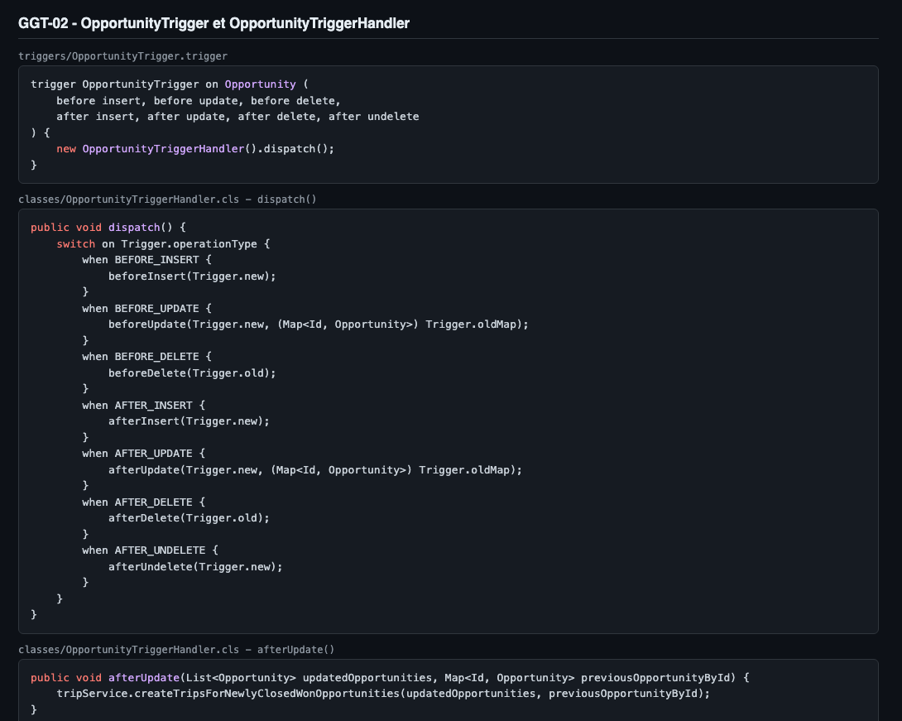

*Figure 8 — Code GGT-02 : OpportunityTrigger, dispatch() et afterUpdate(), réduit à un seul appel au service.*

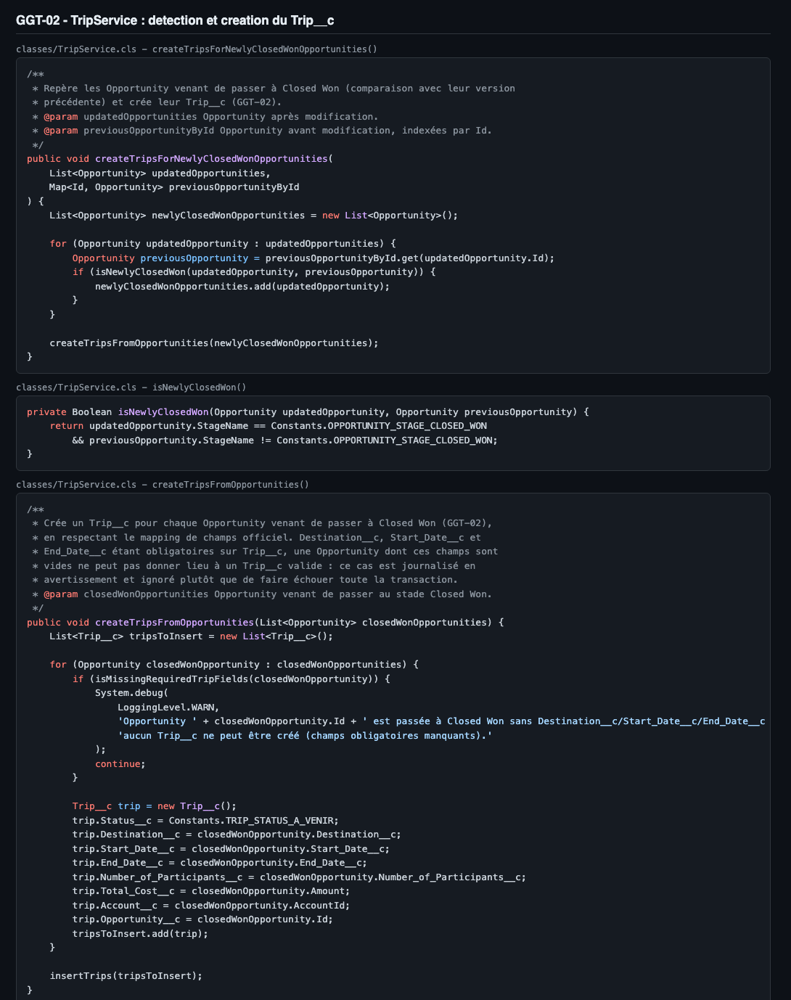

*Figure 9 — Code GGT-02 : TripService détecte la transition vers Closed Won, crée les Trip__c en lot et applique le CRUD/FLS avant l'insertion.*

### GGT-03 — Cohérence des dates

**Besoin métier** : un `Trip__c` créé ou modifié doit avoir une date de fin postérieure à sa date de début.

**Solution technique** : `TripTrigger` (déclaré sur tous les événements, une seule ligne : `new TripTriggerHandler().dispatch()`) délègue à `TripTriggerHandler.dispatch()`. Les méthodes `beforeInsert` et `beforeUpdate` appellent `TripService.validateDateConsistency()`, qui bloque via `addError()` sur le champ `End_Date__c` si `End_Date__c < Start_Date__c`. Implémenté exclusivement en Apex (pas de Validation Rule), comme exigé par le cahier des charges pour démontrer la compétence trigger.


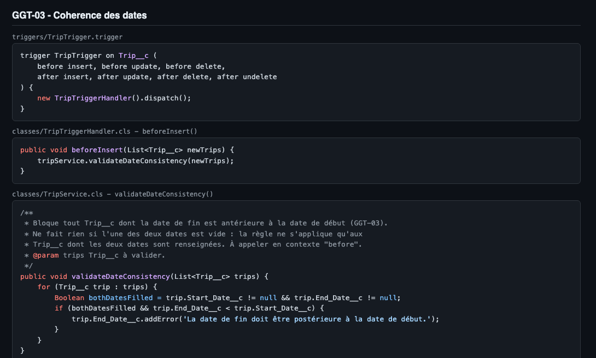

*Figure 10 — Code GGT-03 : TripTrigger, TripTriggerHandler.beforeInsert() et TripService.validateDateConsistency() avec addError().*

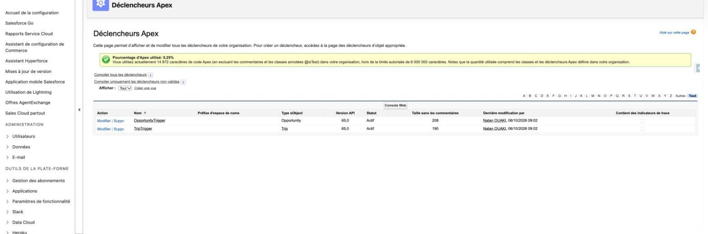

*Figure 11 — Déclencheurs Apex de l'org : OpportunityTrigger et TripTrigger, actifs en version d'API 65.0.*

### GGT-04 — Auto-annulation par sous-effectif

**Besoin métier** : un `Trip__c` doit être auto-annulé si moins de 10 participants sont inscrits à J-7 de la date de début.

**Solution technique** : `TripAutoCancelBatch` (`Database.Batchable<SObject>, Database.Stateful`) lit les seuils (`Min_Participants__c`, `Days_Before_Departure__c`) depuis `Trip_Settings__mdt.Default` plutôt que de les coder en dur, sélectionne les `Trip__c` dont `Start_Date__c` correspond à la date cible, `Number_of_Participants__c` est renseigné et strictement inférieur au seuil, et hors `Status__c = 'Annulé'`. `TripAutoCancelScheduler` (`Schedulable`) planifie ce batch avec une taille de lot explicite (200).


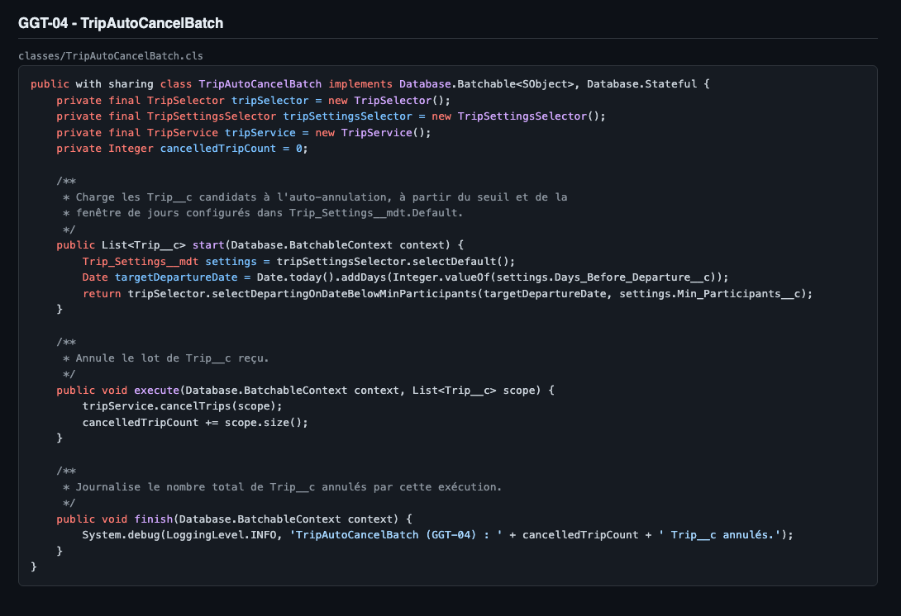

*Figure 12 — Code GGT-04 : TripAutoCancelBatch (start, execute, finish) avec Database.Stateful.*

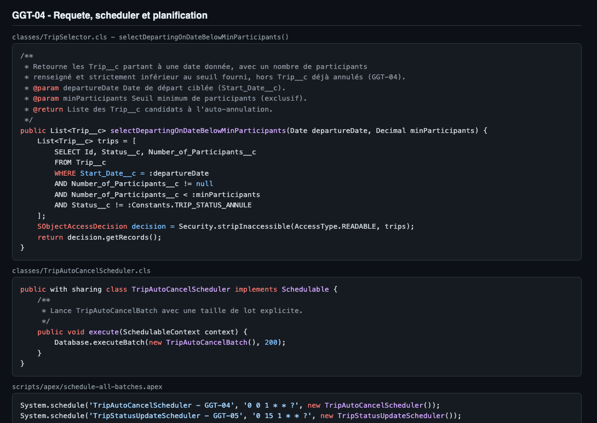

*Figure 13 — Code GGT-04 : requête du TripSelector, TripAutoCancelScheduler et planification quotidienne.*

### GGT-05 — Recalcul automatique de statut

**Besoin métier** : le statut d'un `Trip__c` doit refléter automatiquement les dates (`À venir` / `En cours` / `Terminé`), sauf pour les `Trip__c` déjà `Annulé`.

**Solution technique** : `TripStatusUpdateBatch` charge, via `TripSelector.selectWithOutdatedStatus()`, uniquement les `Trip__c` non annulés dont le statut ne correspond plus à leurs dates : voyage futur non « À venir », voyage passé non « Terminé », ou voyage en cours non « En cours ». L'exclusion de `Status__c = 'Annulé'` se fait dès la requête (jamais de réécriture d'un `Trip__c` annulé). Le batch recalcule ensuite le statut attendu via `TripService.computeStatusForDates()` et ne fait un `update` que si le statut calculé diffère du statut actuel, ce qui reste une seconde protection contre les DML inutiles. `TripStatusUpdateScheduler` planifie ce batch avec une taille de lot explicite (200).


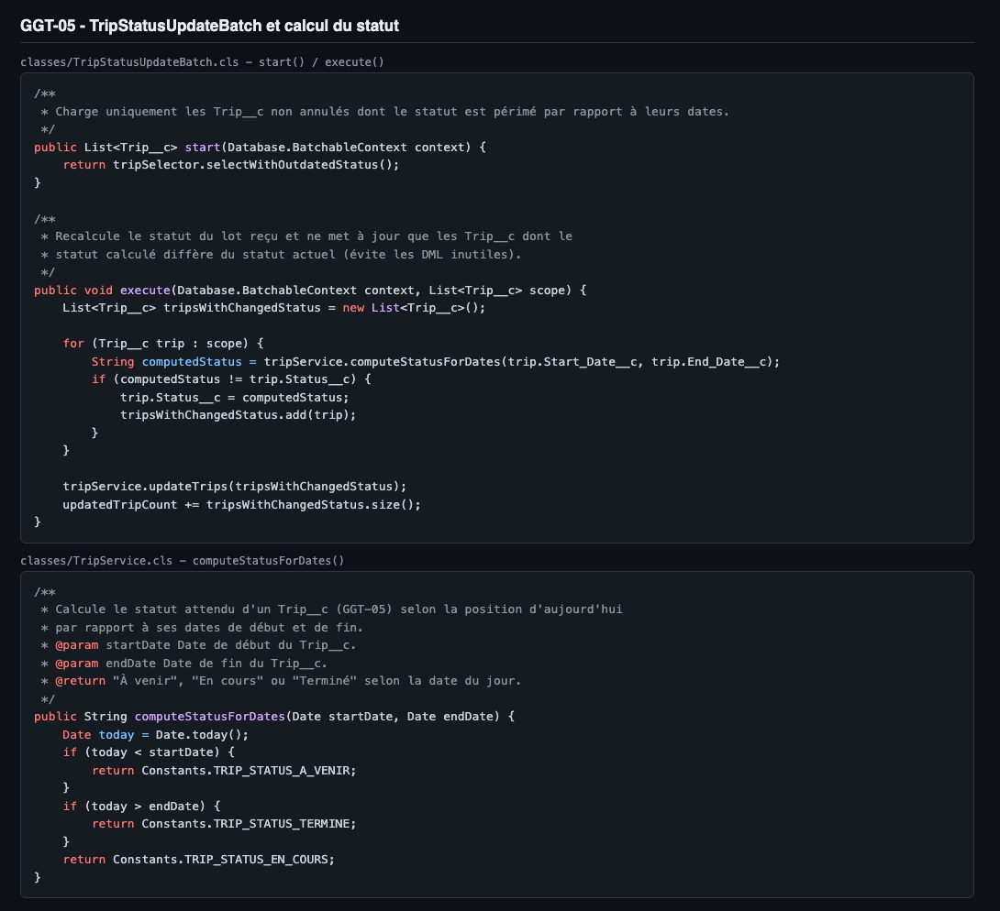

*Figure 14 — Code GGT-05 : TripStatusUpdateBatch et calcul du statut par TripService.computeStatusForDates().*

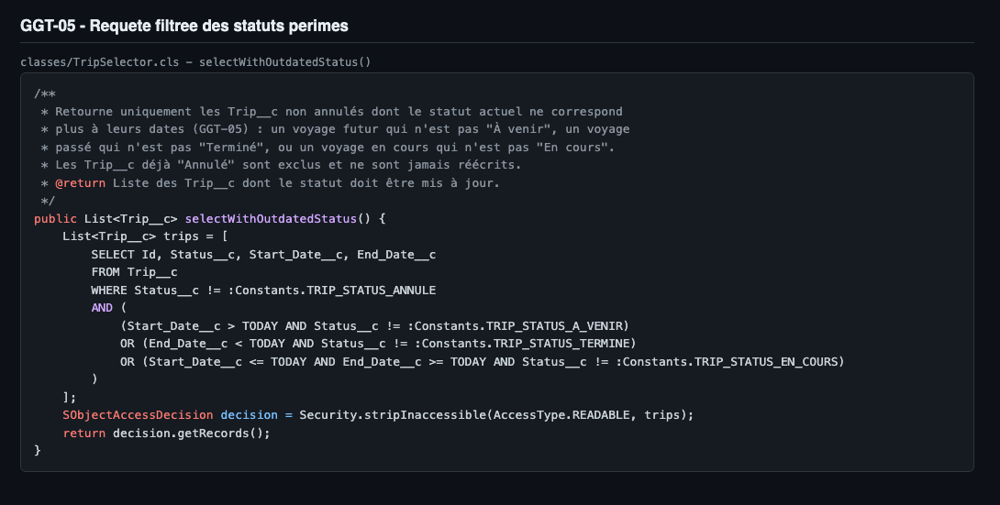

*Figure 15 — Code GGT-05 : requête SOQL filtrée qui ne retourne que les Trip__c dont le statut est périmé.*

### Activation de la planification

`scripts/apex/schedule-all-batches.apex` planifie les deux batchs quotidiens (`TripAutoCancelScheduler` pour GGT-04 et `TripStatusUpdateScheduler` pour GGT-05). Ce script n'est pas exécuté automatiquement : il doit être lancé manuellement par l'équipe GlobalGroupTravel pour activer les schedules.

---

## 5. Points d'implémentation à retenir

Les captures de code de la section 4 montrent chaque fonctionnalité ; voici ce qu'il faut en retenir.

- **GGT-02** : le handler ne fait qu'un appel ; le service compare `Trigger.new` et `Trigger.oldMap` pour ne retenir que les Opportunity qui *viennent de passer* à Closed Won (et non celles qui y sont déjà). Le traitement est bulkifié : un seul `insert` pour toute la liste de `Trip__c`.
- **GGT-03** : `addError()` est posé directement sur `End_Date__c`, ce qui place le message sous le bon champ dans l'interface. Le test `bothDatesFilled` évite toute `NullPointerException` si une date est absente.
- **GGT-04** : les seuils (10 participants, J-7) sont lus dans `Trip_Settings__mdt.Default` et jamais codés en dur ; ils se modifient sans redéploiement de code.
- **GGT-05** : la requête SOQL ne retourne que les `Trip__c` dont le statut est périmé, et le batch ne fait un `update` que si le statut calculé diffère de l'actuel (aucun DML ni déclenchement de trigger inutile).

## 6. Stratégie de tests

### 6.1 Approche

- Une classe de test par classe de production (ou regroupement logique pour les couches Selector/Service).
- `@TestSetup` pour les données communes, `Test.startTest()/stopTest()` autour de la logique bulkifiée/asynchrone.
- Aucune classe de test n'utilise `SeeAllData=true`.
- Scénarios défensifs et cas d'erreur testés en plus du chemin nominal (dates invalides, champs vides, listes vides, non-régression sur repassage Closed Won → Closed Won).
- Test de sécurité dédié (`SecurityAndSharingTest`) exécuté via `System.runAs()` sous un utilisateur n'ayant que le Permission Set `Commercial_GlobalGroupTravel`.
- Tests fonctionnels de bout en bout (`LifecycleEndToEndTest`), qui rejouent le cycle de vie complet d'un voyage (voir 6.5).

### 6.2 Couverture par classe

| Classe | Couverture |
|---|---|
| OpportunityTriggerHandler | 100% |
| TripTriggerHandler | 100% |
| ContractSelector | 100% |
| ContractService | 100% |
| AccountService | 100% |
| OpportunitySelector | 100% |
| OpportunityService | 100% |
| TripSelector | 100% |
| AccountSelector | 100% |
| TripService | 100% |
| TripTrigger | 100% |
| OpportunityTrigger | 100% |
| TripStatusUpdateScheduler | 100% |
| TripAutoCancelBatch | 100% |
| TripAutoCancelScheduler | 100% |
| TripSettingsSelector | 100% |
| TripStatusUpdateBatch | 100% |
| **Couverture globale de l'org** | **100%** (exigence minimale Salesforce : 75% ; objectif du projet : >95%) |


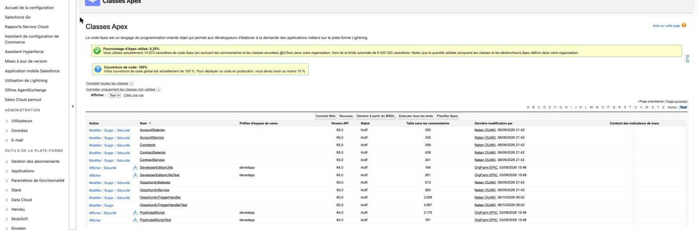

*Figure 16 — Classes Apex de l'org : couverture de code globale de 100 %.*

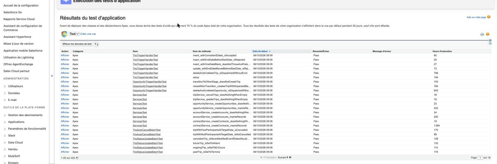

*Figure 17 — Exécution des tests d'application (campagne du 06/10/2026) : tous les tests au statut Pass.*

Résultat complet : `test-results/02-test-run-summary.txt` (45 méthodes de test, 53 exécutions avec les 8 `@TestSetup`, 100% de réussite).

### 6.3 Scénarios de sécurité testés

- Un utilisateur avec uniquement le Permission Set `Commercial_GlobalGroupTravel` ne peut **pas** modifier `Trip__c.Total_Cost__c`, même via `TripService.updateTrips()` (FLS enforcement par `Security.stripInaccessible`, pas seulement déclaratif).
- Un utilisateur hors du groupe `Managers_GlobalGroupTravel` ne voit **pas** les `Trip__c` au statut `Annulé` appartenant à un autre utilisateur (OWD Private + absence de partage).

**Limite documentée** : le pendant « devient visible après ajout au groupe » n'a volontairement pas été testé par une assertion automatisée. Le recalcul de partage déclenché par une Sharing Rule (contrairement à un partage manuel Apex ou à la hiérarchie de rôles) est un traitement asynchrone géré par la plateforme Salesforce, qui ne s'exécute jamais de façon synchrone dans un test Apex, même entre `Test.startTest()`/`stopTest()`. Écrire une assertion sur ce recalcul aurait produit un test non déterministe ne vérifiant rien de fiable ; ce comportement doit être validé manuellement dans l'org (déploiement de la Sharing Rule confirmé avec succès, voir `test-results/04-security-verification.txt`).

### 6.4 Scénarios GGT-04 / GGT-05 testés

- **GGT-04** : Trip__c à J+7 avec `< 10` participants → annulé ; avec `>= 10` → non touché ; avec participants `null` → non touché (exclusion explicite) ; déjà `Annulé` → non re-traité.
- **GGT-05** : pour chaque position temporelle (avant / pendant / après les dates), le statut calculé est correct ; un `Trip__c` déjà `Annulé` n'est jamais modifié par ce batch, même si ses dates correspondraient à `Terminé`.

---

### 6.5 Tests fonctionnels (bout en bout)

Les tests unitaires vérifient chaque règle isolément. Les tests fonctionnels de `LifecycleEndToEndTest` vérifient que les règles s'enchaînent comme dans l'usage réel : on crée les objets, on fait avancer le cycle de vie, et on contrôle le résultat à chaque étape. Les batchs de nuit sont exécutés comme le ferait la planification, une fois par « nuit » simulée, et les dates du voyage sont décalées pour simuler le passage du temps.

| Scénario | Étapes simulées | Résultat attendu |
|---|---|---|
| **Voyage signé qui se déroule normalement** | 1. Création d'un compte, puis d'une Opportunity (Prospecting) avec destination, dates, participants et montant. 2. Passage à Closed Won. 3. Nuit avec départ dans 30 jours. 4. Jour du départ. 5. Après la date de fin. | Un `Trip__c` est créé automatiquement (« À venir », montant et participants repris). Il reste « À venir », passe « En cours » le jour du départ, puis « Terminé ». |
| **Voyage sous-rempli annulé à J-7** | 1. Opportunity signée avec 6 participants (seuil : 10) et un départ à J+7. 2. Batch d'auto-annulation. 3. Dates décalées dans le passé, puis batch de recalcul de statut. | Le voyage passe « Annulé ». Le recalcul de statut ne le modifie jamais, même avec des dates passées. |
| **Lot de trois Opportunity signées en même temps** | Un voyage complet, un voyage sous-rempli et une Opportunity sans dates, passés à Closed Won ensemble, puis les deux batchs de nuit. | Deux `Trip__c` seulement (celui sans dates est ignoré sans bloquer les autres). Le voyage complet reste « À venir », le sous-rempli est « Annulé ». |


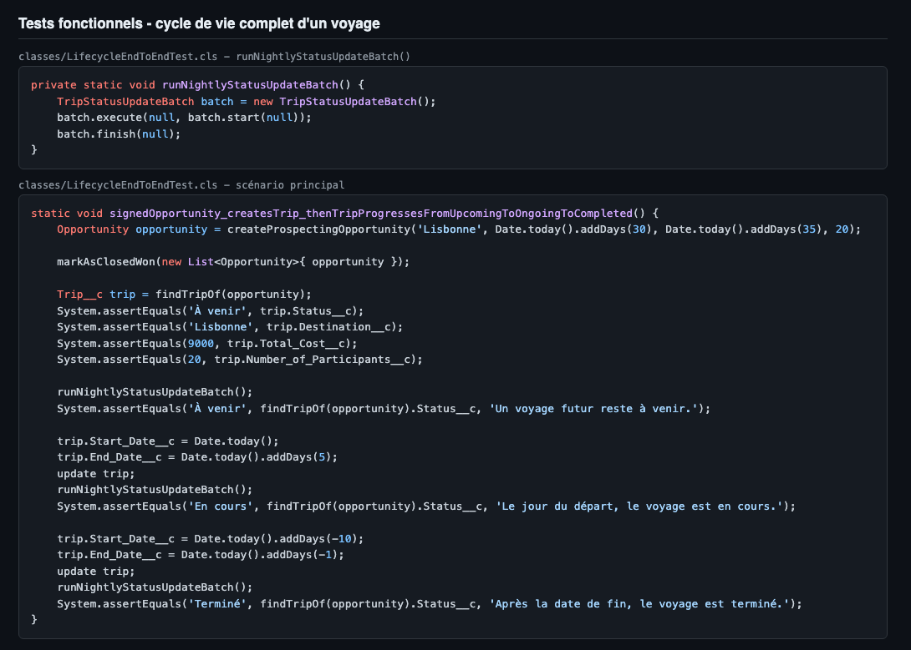

*Figure 18 — Test fonctionnel : de la signature de l'Opportunity jusqu'au voyage terminé, avec une exécution du batch de nuit à chaque étape.*

Ces trois scénarios s'exécutent avec les mêmes données de configuration (`Trip_Settings__mdt`) que la production et passent tous au statut Pass (voir le rapport de tests).

---

## 7. Limites connues et pistes d'évolution

- **Salesforce Shield non installable dans cette org** (Developer Edition gratuite) : la sécurité repose sur OWD/rôles/Permission Set/Sharing Rule/FLS + enforcement applicatif ; pas de chiffrement au repos ni d'audit trail avancé. À réévaluer si l'org passe en édition payante.
- **OWD Opportunity en Private plutôt que Controlled by Parent** (limitation de l'API Metadata Salesforce, voir section 3.1) : un Manager ne voit pas automatiquement les Opportunity de ses commerciaux subordonnés. Piste : ajouter une Sharing Rule basée sur les rôles dédiée à Opportunity si ce besoin se confirme en usage réel.
- **Sharing Rule sur `Trip__c` simple** : un seul critère (`Status__c = 'Annulé'`) partagé avec un seul groupe. À complexifier (plusieurs groupes, plusieurs statuts) si l'organisation commerciale de GlobalGroupTravel grandit.
