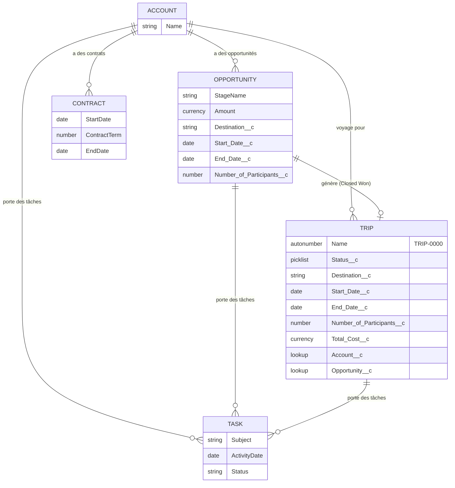

# GlobalGroupTravel-CRM — Documentation Technique

> Projet Salesforce DX pour GlobalGroupTravel, fournisseur de voyages de groupe à l'international et pour entreprises. Ce document couvre le modèle de données, le modèle de sécurité, les règles métier GGT-01 à GGT-05, la stratégie de tests et les limites connues.
>
> **Note sur les captures d'écran** : les captures littérales de l'interface Setup Salesforce (Schema Builder, résultats de test dans l'UI Apex Test Execution) ne sont pas incluses dans ce document — Claude Code n'a pas d'accès visuel à l'org en ligne. Elles seront ajoutées manuellement par le développeur après revue.

---

## 1. Introduction

GlobalGroupTravel est un fournisseur de voyages de groupe (écoles, associations sportives, entreprises) qui a besoin d'un CRM Salesforce pour :

- suivre son cycle de vente (Account → Opportunity → Contract) ;
- automatiser la création d'un dossier voyage (`Trip__c`) dès qu'une vente est conclue ;
- garantir la cohérence des dates de voyage ;
- annuler automatiquement les voyages qui n'atteignent pas un seuil minimum de participants à l'approche du départ ;
- refléter automatiquement le statut réel de chaque voyage (à venir / en cours / terminé) sans intervention manuelle.

Ce projet livre l'architecture de données, la sécurité et les automatisations Apex répondant à ces besoins, sur une org Salesforce Developer Edition, sans dépendance à Salesforce Shield (non disponible sur Developer Edition gratuite).

---

## 2. Schéma du modèle de données

### 2.1 Diagramme ERD



### 2.2 Détail des champs custom

**`Trip__c`** (sharing model : Private)

| Champ (Label) | API Name | Type | Détails |
|---|---|---|---|
| Trip Name | `Name` | Auto Number | Format `TRIP-{0000}`, démarre à 1 |
| Status | `Status__c` | Picklist | `À venir` (défaut), `En cours`, `Terminé`, `Annulé` |
| Destination | `Destination__c` | Text(255) | Obligatoire |
| Start Date | `Start_Date__c` | Date | Obligatoire |
| End Date | `End_Date__c` | Date | Obligatoire |
| Number of Participants | `Number_of_Participants__c` | Number(3,0) | Optionnel — peut être vide (GGT-04 exclut explicitement les valeurs vides) |
| Total Cost | `Total_Cost__c` | Currency(16,2) | Champ éditable classique, alimenté depuis `Opportunity.Amount` à la création |
| Account | `Account__c` | Lookup(Account) | Obligatoire |
| Opportunity | `Opportunity__c` | Lookup(Opportunity) | Optionnel (un Trip peut être créé manuellement) |

**`Opportunity`** — champs custom ajoutés (GGT-01)

| Champ (Label) | API Name | Type |
|---|---|---|
| Number of Participants | `Number_of_Participants__c` | Number(3,0) |
| Destination | `Destination__c` | Text(255) |
| Start Date | `Start_Date__c` | Date |
| End Date | `End_Date__c` | Date |

**`Trip_Settings__mdt`** (Custom Metadata Type)

| Champ | API Name | Type | Valeur (`Default`) |
|---|---|---|---|
| Min Participants | `Min_Participants__c` | Number | 10 |
| Days Before Departure | `Days_Before_Departure__c` | Number | 7 |

### 2.3 Validation Rules déclaratives

| Objet | Nom | Règle |
|---|---|---|
| `Trip__c` | `Trip_Participants_Positive` | Bloque si `Number_of_Participants__c` est renseigné ET `≤ 0` |
| `Opportunity` | `Opportunity_Amount_Not_Negative` | Bloque si `Amount < 0` |

La cohérence des dates de `Trip__c` (GGT-03) est volontairement **exclue** des Validation Rules déclaratives et implémentée en Apex (trigger), conformément au cahier des charges.

### 2.4 Autres objets

- **Account** : champs standards suffisants.
- **Contract** : champs standards (`StartDate`, `ContractTerm`, `EndDate` calculé), aucune automatisation.
- **Task** : liée via `WhatId` à Account / Opportunity / Trip__c.
- **User** : aucun objet custom ; gestion des commerciaux via Profils + Permission Set sur les Users existants.

---

## 3. Modèle de sécurité

### 3.1 Org-Wide Defaults (OWD)

| Objet | OWD déployé |
|---|---|
| `Account` | Private |
| `Contract` | Private |
| `Trip__c` | Private |
| `Task` | Controlled by Parent |
| `Opportunity` | **Private** (voir écart documenté ci-dessous) |
| `Case` | Private (effet de bord, voir ci-dessous) |

**Écart par rapport au cahier des charges — Opportunity OWD** : les notes de cadrage demandaient `Opportunity : Controlled by Parent`. L'API Metadata Salesforce **rejette explicitement** cette valeur pour l'objet Opportunity (`ControlledByParent is not a valid sharing model for Opportunity`), bien que l'interface Setup l'autorise dans certains contextes. `Opportunity` a donc été déployé en **Private**. Conséquence : un Manager ne voit pas automatiquement les Opportunity de ses commerciaux via la seule hiérarchie de rôles ; seuls Account, Contract et Trip__c en bénéficient pleinement. Piste d'évolution : ajouter une Sharing Rule basée sur les rôles si ce besoin se confirme.

**Effet de bord — Case** : passer `Account` à Private a forcé Salesforce à revalider le sharing model de `Case` (objet standard non demandé dans ce projet), dont la valeur par défaut (`ReadWriteTransfer`) devenait incompatible. `Case` a donc été mis à `Private` pour permettre le déploiement, sans conséquence fonctionnelle puisque `Case` n'est pas utilisé dans ce projet.

### 3.2 Rôles hiérarchiques

Une hiérarchie à 2 niveaux a été créée, conformément à l'exigence d'utiliser rôles **et** profils :

```
Manager Commercial GlobalGroupTravel
        └── Commercial GlobalGroupTravel
```

Avec un OWD Private sur `Account`/`Contract`/`Trip__c`, cette hiérarchie permet à un Manager de voir automatiquement les enregistrements de ses commerciaux subordonnés, sans élargir la Sharing Rule ci-dessous — les deux mécanismes sont complémentaires, pas redondants.

### 3.3 Permission Set `Commercial_GlobalGroupTravel`

CRUD complet sur `Account`, `Opportunity`, `Contract`, `Task`, `Trip__c`. FLS restreinte : `Trip__c.Total_Cost__c` en **lecture seule** (le montant total du voyage n'est éditable que par un administrateur).

> Note technique : les champs marqués `required=true` (ex. `Trip__c.Destination__c`, `Start_Date__c`, `End_Date__c`, `Account__c`, `Status__c`) sont toujours pleinement accessibles côté plateforme Salesforce et ne peuvent pas recevoir d'entrée FLS explicite — seuls les champs optionnels apparaissent dans le Permission Set.

### 3.4 Sharing Rule

Une Criteria-Based Sharing Rule sur `Trip__c` partage en lecture seule les enregistrements `Status__c = 'Annulé'` avec le Public Group `Managers_GlobalGroupTravel` (groupe vide à la livraison, alimenté par l'équipe GlobalGroupTravel).

### 3.5 Enforcement dans le code

Toutes les classes Selector et Service sont déclarées `with sharing`. Toute opération DML issue de données manipulées par le code applique `Security.stripInaccessible(AccessType.CREATABLE/UPDATABLE/READABLE, records)` avant écriture ou lecture, garantissant le respect du CRUD/FLS de l'utilisateur courant même en dehors du contexte déclaratif.

**Point d'attention découvert en testant** : au format source SFDX, un champ custom optionnel ne reçoit **aucune** FLS pour un profil tant qu'aucun fichier Profile/Permission Set ne le déclare explicitement — y compris pour le profil Administrateur Système. Le fichier `force-app/main/default/profiles/Admin.profile-meta.xml` accorde donc explicitement la FLS sur les champs optionnels utilisés avec `Security.stripInaccessible` (`Trip__c.Number_of_Participants__c`, `Trip__c.Total_Cost__c`, `Trip__c.Opportunity__c`, et les 4 champs custom d'`Opportunity`), afin que l'administrateur ne se voie pas lui-même privé de ces champs par le CRUD/FLS enforcement du code.

### 3.6 Non-utilisation de Salesforce Shield

Ce projet est développé sur une org Developer Edition gratuite, sur laquelle Salesforce Shield (Platform Encryption, Event Monitoring, Field Audit Trail) n'est pas disponible. La sécurité repose donc entièrement sur les mécanismes natifs et gratuits de la plateforme : OWD, rôles, Permission Set, Sharing Rule, FLS et enforcement applicatif (`with sharing` + `Security.stripInaccessible`).

---

## 4. Liste des fonctionnalités (GGT-01 à GGT-05)

### GGT-01 — Modèle de données

**Besoin métier** : disposer de l'objet `Trip__c` et de ses champs, ainsi que des champs custom nécessaires sur `Opportunity` pour capturer les informations de voyage dès la phase commerciale.

**Solution technique** : objet `Trip__c` (8 champs), 4 champs custom sur `Opportunity`, Custom Metadata Type `Trip_Settings__mdt` pour paramétrer GGT-04 sans valeur codée en dur, 2 Validation Rules déclaratives. Voir section 2.

### GGT-02 — Création automatique de Trip__c à la signature

**Besoin métier** : quand une Opportunity passe à `Closed Won`, un `Trip__c` doit être créé automatiquement avec des valeurs par défaut, lié à l'Account de l'opportunité.

**Solution technique** : `OpportunityTrigger` (`after update`) délègue à `OpportunityTriggerHandler`, qui détecte la transition vers `Closed Won` (comparaison `Trigger.new` / `Trigger.oldMap`, bulkifiée) et appelle `TripService.createTripsFromOpportunities()`. Le mapping de champs suit exactement la spécification (voir extrait de code section 5).

**Cas limite géré** : `Destination__c`, `Start_Date__c` et `End_Date__c` étant obligatoires sur `Trip__c`, une Opportunity Closed Won dont ces champs sont vides ne peut structurellement pas produire de `Trip__c` valide. Ce cas est journalisé en avertissement (`System.debug`) et l'Opportunity est ignorée, plutôt que de faire échouer toute la transaction (bulkifiée) pour les autres Opportunity du lot.

### GGT-03 — Cohérence des dates

**Besoin métier** : un `Trip__c` créé ou modifié doit avoir une date de fin postérieure à sa date de début.

**Solution technique** : `TripTrigger` (`before insert`, `before update`) délègue à `TripTriggerHandler.validateDateConsistency()`, qui bloque via `addError()` sur le champ `End_Date__c` si `End_Date__c < Start_Date__c`. Implémenté exclusivement en Apex (pas de Validation Rule), comme exigé par le cahier des charges pour démontrer la compétence trigger.

### GGT-04 — Auto-annulation par sous-effectif

**Besoin métier** : un `Trip__c` doit être auto-annulé si moins de 10 participants sont inscrits à J-7 de la date de début.

**Solution technique** : `TripAutoCancelBatch` (`Database.Batchable<SObject>, Database.Stateful`) lit les seuils (`Min_Participants__c`, `Days_Before_Departure__c`) depuis `Trip_Settings__mdt.Default` plutôt que de les coder en dur, sélectionne les `Trip__c` dont `Start_Date__c` correspond à la date cible, `Number_of_Participants__c` est renseigné et strictement inférieur au seuil, et hors `Status__c = 'Annulé'`. `TripAutoCancelScheduler` (`Schedulable`) planifie ce batch avec une taille de lot explicite (200).

### GGT-05 — Recalcul automatique de statut

**Besoin métier** : le statut d'un `Trip__c` doit refléter automatiquement les dates (`À venir` / `En cours` / `Terminé`), sauf pour les `Trip__c` déjà `Annulé`.

**Solution technique** : `TripStatusUpdateBatch` charge, via `TripSelector.selectWithOutdatedStatus()`, uniquement les `Trip__c` non annulés dont le statut ne correspond plus à leurs dates : voyage futur non « À venir », voyage passé non « Terminé », ou voyage en cours non « En cours ». L'exclusion de `Status__c = 'Annulé'` se fait dès la requête (jamais de réécriture d'un `Trip__c` annulé). Le batch recalcule ensuite le statut attendu via `TripService.computeStatusForDates()` et ne fait un `update` que si le statut calculé diffère du statut actuel, ce qui reste une seconde protection contre les DML inutiles. `TripStatusUpdateScheduler` planifie ce batch avec une taille de lot explicite (200).

### Ordre de planification

`scripts/apex/schedule-all-batches.apex` planifie `TripAutoCancelScheduler` à 01h00 puis `TripStatusUpdateScheduler` à 01h15, pour laisser le temps au premier batch de finir avant que le second n'exclue les `Trip__c` qui viennent d'être annulés. Ce script n'est pas exécuté automatiquement ; il doit être lancé manuellement par l'équipe GlobalGroupTravel pour activer les schedules.

---

## 5. Extraits de code commentés

### GGT-02 — Détection de la transition Closed Won (`OpportunityTriggerHandler.cls`)

```apex
public void afterUpdate(List<Opportunity> updatedOpportunities, Map<Id, Opportunity> previousOpportunityById) {
    List<Opportunity> newlyClosedWonOpportunities = new List<Opportunity>();

    for (Opportunity updatedOpportunity : updatedOpportunities) {
        Opportunity previousOpportunity = previousOpportunityById.get(updatedOpportunity.Id);
        Boolean justClosedWon = updatedOpportunity.StageName == Constants.OPPORTUNITY_STAGE_CLOSED_WON
            && previousOpportunity.StageName != Constants.OPPORTUNITY_STAGE_CLOSED_WON;

        if (justClosedWon) {
            newlyClosedWonOpportunities.add(updatedOpportunity);
        }
    }

    if (!newlyClosedWonOpportunities.isEmpty()) {
        tripService.createTripsFromOpportunities(newlyClosedWonOpportunities);
    }
}
```

Ce code répond au besoin en ne créant un `Trip__c` que pour les Opportunity qui **viennent de passer** à Closed Won (et non celles qui y sont déjà, ou qui en repartent), et en restant bulkifié pour supporter un update de masse.

### GGT-03 — Validation de cohérence des dates (`TripTriggerHandler.cls`)

```apex
public void validateDateConsistency(List<Trip__c> trips) {
    for (Trip__c trip : trips) {
        Boolean bothDatesFilled = trip.Start_Date__c != null && trip.End_Date__c != null;
        if (bothDatesFilled && trip.End_Date__c < trip.Start_Date__c) {
            trip.End_Date__c.addError('La date de fin doit être postérieure à la date de début.');
        }
    }
}
```

L'utilisation de `addError()` directement sur le champ `End_Date__c` place l'erreur au bon endroit dans l'UI Salesforce (sous le champ concerné), et le test `bothDatesFilled` évite tout NullPointerException si l'une des deux dates est absente.

### GGT-04 — Lecture des seuils configurables (`TripAutoCancelBatch.cls`)

```apex
public List<Trip__c> start(Database.BatchableContext context) {
    Trip_Settings__mdt settings = tripSettingsSelector.selectDefault();
    Date targetDepartureDate = Date.today().addDays(Integer.valueOf(settings.Days_Before_Departure__c));
    return tripSelector.selectDepartingOnDateBelowMinParticipants(targetDepartureDate, settings.Min_Participants__c);
}
```

Les seuils métier (10 participants, J-7) ne sont jamais codés en dur : ils sont lus depuis `Trip_Settings__mdt.Default`, ce qui permet de les ajuster sans redéploiement de code.

### GGT-05 — Recalcul conditionnel (`TripStatusUpdateBatch.cls`)

```apex
public void execute(Database.BatchableContext context, List<Trip__c> scope) {
    List<Trip__c> tripsWithChangedStatus = new List<Trip__c>();

    for (Trip__c trip : scope) {
        String computedStatus = tripService.computeStatusForDates(trip.Start_Date__c, trip.End_Date__c);
        if (computedStatus != trip.Status__c) {
            trip.Status__c = computedStatus;
            tripsWithChangedStatus.add(trip);
        }
    }

    tripService.updateTrips(tripsWithChangedStatus);
    updatedTripCount += tripsWithChangedStatus.size();
}
```

Le `start()` de ce batch appelle `TripSelector.selectWithOutdatedStatus()`, dont la requête exclut déjà les `Trip__c` `Annulé` et ne retourne que ceux dont le statut est périmé par rapport aux dates :

```apex
WHERE Status__c != :Constants.TRIP_STATUS_ANNULE
AND (
    (Start_Date__c > TODAY AND Status__c != :Constants.TRIP_STATUS_A_VENIR)
    OR (End_Date__c < TODAY AND Status__c != :Constants.TRIP_STATUS_TERMINE)
    OR (Start_Date__c <= TODAY AND End_Date__c >= TODAY AND Status__c != :Constants.TRIP_STATUS_EN_COURS)
)
```

Le filtrage se fait donc dans la base de données plutôt qu'en mémoire Apex, ce qui évite de charger des milliers de `Trip__c` inutiles. Ce code d'`execute` ne fait en plus un `update` que sur les enregistrements dont le statut calculé diffère réellement de l'actuel, évitant des DML et des déclenchements de trigger inutiles.

---

## 6. Stratégie de tests

### 6.1 Approche

- Une classe de test par classe de production (ou regroupement logique pour les couches Selector/Service).
- `@TestSetup` pour les données communes, `Test.startTest()/stopTest()` autour de la logique bulkifiée/asynchrone.
- Aucune classe de test n'utilise `SeeAllData=true`.
- Scénarios défensifs et cas d'erreur testés en plus du chemin nominal (dates invalides, champs vides, listes vides, non-régression sur repassage Closed Won → Closed Won).
- Test de sécurité dédié (`SecurityAndSharingTest`) exécuté via `System.runAs()` sous un utilisateur n'ayant que le Permission Set `Commercial_GlobalGroupTravel`.

### 6.2 Couverture par classe

| Classe | Couverture |
|---|---|
| OpportunityTriggerHandler | 100% |
| TripTriggerHandler | 100% |
| ContractSelector | 100% |
| ContractService | 100% |
| AccountService | 100% |
| OpportunitySelector | 100% |
| OpportunityService | 100% |
| TripSelector | 100% |
| AccountSelector | 100% |
| TripService | 100% |
| TripTrigger | 100% |
| OpportunityTrigger | 100% |
| TripStatusUpdateScheduler | 100% |
| TripAutoCancelBatch | 100% |
| TripAutoCancelScheduler | 100% |
| TripSettingsSelector | 100% |
| TripStatusUpdateBatch | 100% |
| **Couverture globale de l'org** | **100%** (exigence minimale Salesforce : 75% ; objectif du projet : >95%) |

Résultat complet : `test-results/02-test-run-summary.txt` (45 tests, 100% de réussite).

### 6.3 Scénarios de sécurité testés

- Un utilisateur avec uniquement le Permission Set `Commercial_GlobalGroupTravel` ne peut **pas** modifier `Trip__c.Total_Cost__c`, même via `TripService.updateTrips()` (FLS enforcement par `Security.stripInaccessible`, pas seulement déclaratif).
- Un utilisateur hors du groupe `Managers_GlobalGroupTravel` ne voit **pas** les `Trip__c` au statut `Annulé` appartenant à un autre utilisateur (OWD Private + absence de partage).

**Limite documentée** : le pendant « devient visible après ajout au groupe » n'a volontairement pas été testé par une assertion automatisée. Le recalcul de partage déclenché par une Sharing Rule (contrairement à un partage manuel Apex ou à la hiérarchie de rôles) est un traitement asynchrone géré par la plateforme Salesforce, qui ne s'exécute jamais de façon synchrone dans un test Apex, même entre `Test.startTest()`/`stopTest()`. Écrire une assertion sur ce recalcul aurait produit un test non déterministe ne vérifiant rien de fiable ; ce comportement doit être validé manuellement dans l'org (déploiement de la Sharing Rule confirmé avec succès, voir `test-results/04-security-verification.txt`).

### 6.4 Scénarios GGT-04 / GGT-05 testés

- **GGT-04** : Trip__c à J+7 avec `< 10` participants → annulé ; avec `>= 10` → non touché ; avec participants `null` → non touché (exclusion explicite) ; déjà `Annulé` → non re-traité.
- **GGT-05** : pour chaque position temporelle (avant / pendant / après les dates), le statut calculé est correct ; un `Trip__c` déjà `Annulé` n'est jamais modifié par ce batch, même si ses dates correspondraient à `Terminé`.

---

## 7. Limites connues et pistes d'évolution

- **Pas de Salesforce Shield** : la sécurité repose sur OWD/rôles/Permission Set/Sharing Rule/FLS + enforcement applicatif ; pas de chiffrement au repos ni d'audit trail avancé. À réévaluer si l'org passe en édition payante.
- **OWD Opportunity en Private plutôt que Controlled by Parent** (limitation de l'API Metadata Salesforce, voir section 3.1) : un Manager ne voit pas automatiquement les Opportunity de ses commerciaux subordonnés. Piste : ajouter une Sharing Rule basée sur les rôles dédiée à Opportunity si ce besoin se confirme en usage réel.
- **Sharing Rule sur `Trip__c` simple** : un seul critère (`Status__c = 'Annulé'`) partagé avec un seul groupe. À complexifier (plusieurs groupes, plusieurs statuts) si l'organisation commerciale de GlobalGroupTravel grandit.
- **Ordre de planification des deux batchs** : `TripAutoCancelScheduler` (01h00) doit terminer avant `TripStatusUpdateScheduler` (01h15) pour que ce dernier ne recalcule pas le statut d'un `Trip__c` qui vient d'être annulé. Ce délai de 15 minutes est calibré pour le volume de données actuel ; à surveiller et éventuellement élargir si le nombre de `Trip__c` traités par lot augmente significativement.
- **FLS Admin explicite requise** : au format source SFDX, les champs custom optionnels ne reçoivent aucune FLS automatique, y compris pour le profil Administrateur Système (voir section 3.5). Tout nouveau champ optionnel introduit à l'avenir devra recevoir une entrée FLS explicite dans `Admin.profile-meta.xml` (ou un Permission Set dédié) pour rester utilisable avec `Security.stripInaccessible`.
