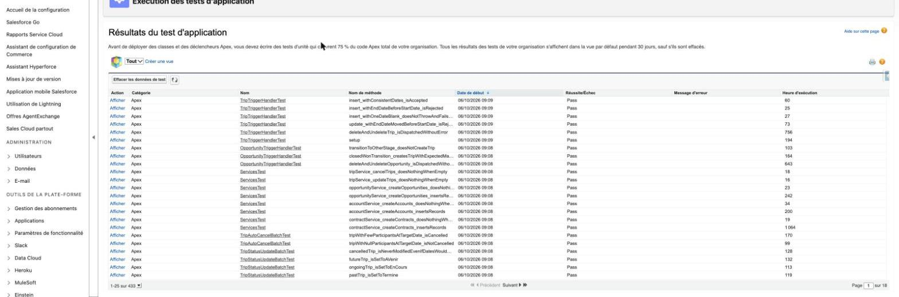

# GlobalGroupTravel-CRM — Rapport de tests

> Campagne exécutée sur l'org `OC_Projet08` (Developer Edition) avec `sf apex run test --test-level RunLocalTests --code-coverage`.

## 1. Synthèse

| Indicateur | Résultat |
|---|---|
| Méthodes de test | **42**, toutes réussies |
| Exécutions comptées par Salesforce | 49 (42 méthodes de test + 7 méthodes `@TestSetup`) |
| Taux de réussite | **100%** |
| Taux d'échec | 0% |
| Couverture de code globale de l'org | **100%** (minimum Salesforce : 75 %) |
| Durée d'exécution | 18717 ms |

## 2. Types de tests effectués

- **Tests unitaires** : chaque classe de production a sa classe de test (Selectors, Services, handlers, batchs, schedulers). Les services sont appelés directement, sans trigger.
- **Tests d'intégration au niveau plateforme** : DML réels (insert, update, delete, undelete) qui traversent le trigger, le handler et le service, pour couvrir chaque branche de `dispatch()`.
- **Tests de volumétrie (bulk)** : 200 Opportunity passées à Closed Won en une seule opération.
- **Tests asynchrones** : `Test.startTest()` / `Test.stopTest()` autour de `Database.executeBatch(..., 200)` pour exécuter les batchs de façon synchrone dans le test.
- **Tests de sécurité** : `System.runAs()` sous un utilisateur n'ayant que le Permission Set commercial.
- **Cas limites** : dates invalides, champs obligatoires vides, participants à `null`, voyage déjà annulé, Closed Won → Closed Won.
- Aucun test n'utilise `SeeAllData=true`.

## 3. Résultats par classe de test

| Classe de test | Périmètre | Tests | Résultat |
|---|---|---|---|
| `TripTriggerHandlerTest` | GGT-03 : cohérence des dates (insert, update, delete/undelete) | 5 | 5/5 Pass |
| `TripAutoCancelBatchTest` | GGT-04 : auto-annulation (seuil, null, déjà annulé) | 4 | 4/4 Pass |
| `SecurityAndSharingTest` | Sécurité : FLS via runAs et partage des voyages annulés | 2 | 2/2 Pass |
| `TripStatusUpdateBatchTest` | GGT-05 : recalcul de statut (avant / pendant / après, Annulé intact) | 4 | 4/4 Pass |
| `ServicesTest` | Couche Service (création de données) | 8 | 8/8 Pass |
| `TripServiceTest` | Logique métier : mapping GGT-02, détection de transition, statut, annulation | 7 | 7/7 Pass |
| `OpportunityTriggerHandlerTest` | GGT-02 : création du Trip à Closed Won (transition, bulk de 200, doublon) | 5 | 5/5 Pass |
| `SelectorsTest` | Couche Selector (lecture des données) | 5 | 5/5 Pass |
| `TripSchedulersTest` | Planification des deux batchs | 2 | 2/2 Pass |

## 4. Détail des tests

**TripTriggerHandlerTest**

- `deleteAndUndeleteTrip_isDispatchedWithoutError` — Pass
- `insert_withConsistentDates_isAccepted` — Pass
- `insert_withEndDateBeforeStartDate_isRejected` — Pass
- `insert_withOneDateBlank_doesNotThrowAndFailsOnRequiredFieldInstead` — Pass
- `update_withEndDateMovedBeforeStartDate_isRejected` — Pass

**TripAutoCancelBatchTest**

- `alreadyCancelledTrip_isNotReprocessed` — Pass
- `tripWithEnoughParticipantsAtTargetDate_isNotCancelled` — Pass
- `tripWithFewParticipantsAtTargetDate_isCancelled` — Pass
- `tripWithNullParticipantsAtTargetDate_isNotCancelled` — Pass

**SecurityAndSharingTest**

- `cancelledTrip_isNotVisibleWithoutManagersGroupMembership` — Pass
- `restrictedUser_cannotEditTotalCostEvenThroughTripService` — Pass

**TripStatusUpdateBatchTest**

- `cancelledTrip_isNeverModifiedEvenIfDatesWouldMeanTermine` — Pass
- `futureTrip_isSetToAVenir` — Pass
- `ongoingTrip_isSetToEnCours` — Pass
- `pastTrip_isSetToTermine` — Pass

**ServicesTest**

- `accountService_createAccounts_doesNothingWhenEmpty` — Pass
- `accountService_createAccounts_insertsRecords` — Pass
- `contractService_createContracts_doesNothingWhenEmpty` — Pass
- `contractService_createContracts_insertsRecords` — Pass
- `opportunityService_createOpportunities_doesNothingWhenEmpty` — Pass
- `opportunityService_createOpportunities_insertsRecords` — Pass
- `tripService_cancelTrips_doesNothingWhenEmpty` — Pass
- `tripService_updateTrips_doesNothingWhenEmpty` — Pass

**TripServiceTest**

- `cancelTrips_setsStatusToAnnule` — Pass
- `computeStatusForDates_returnsExpectedStatusForEachPeriod` — Pass
- `createTripsForNewlyClosedWonOpportunities_createsTripOnlyForTransitionToClosedWon` — Pass
- `createTripsForNewlyClosedWonOpportunities_doesNothingWhenNoOpportunityIsNewlyClosedWon` — Pass
- `createTripsFromOpportunities_mapsAllFieldsFromClosedWonOpportunity` — Pass
- `createTripsFromOpportunities_skipsOpportunityMissingRequiredTripFieldsWithoutError` — Pass
- `insertTrips_doesNothingWhenListEmpty` — Pass

**OpportunityTriggerHandlerTest**

- `alreadyClosedWonOpportunity_updatedAgain_doesNotCreateDuplicateTrip` — Pass
- `bulkClosedWonTransition_createsOneTripPerOpportunity` — Pass
- `closedWonTransition_createsTripWithExpectedMapping` — Pass
- `deleteAndUndeleteOpportunity_isDispatchedWithoutCreatingTrip` — Pass
- `transitionToOtherStage_doesNotCreateTrip` — Pass

**SelectorsTest**

- `accountSelector_selectByIds_returnsMatchingAccounts` — Pass
- `contractSelector_selectByIds_returnsMatchingContracts` — Pass
- `opportunitySelector_selectByIds_returnsMatchingOpportunities` — Pass
- `tripSelector_selectByIds_returnsMatchingTrips` — Pass
- `tripSettingsSelector_selectDefault_returnsConfiguredThresholds` — Pass

**TripSchedulersTest**

- `tripAutoCancelScheduler_schedulesUnderlyingBatch` — Pass
- `tripStatusUpdateScheduler_schedulesUnderlyingBatch` — Pass

## 5. Couverture de code par classe

| Classe | Couverture |
|---|---|
| `OpportunityTriggerHandler` | 100 % |
| `TripTriggerHandler` | 100 % |
| `ContractSelector` | 100 % |
| `ContractService` | 100 % |
| `AccountService` | 100 % |
| `OpportunitySelector` | 100 % |
| `OpportunityService` | 100 % |
| `TripSelector` | 100 % |
| `AccountSelector` | 100 % |
| `Constants` | 0 % |
| `TripService` | 100 % |
| `TripTrigger` | 100 % |
| `OpportunityTrigger` | 100 % |
| `TripStatusUpdateScheduler` | 100 % |
| `TripAutoCancelBatch` | 100 % |
| `TripAutoCancelScheduler` | 100 % |
| `TripSettingsSelector` | 100 % |
| `TripStatusUpdateBatch` | 100 % |

La classe `Constants` n'apparaît pas avec une couverture significative : elle ne contient que des constantes `static final`, sans ligne exécutable.

## 6. Corrections apportées suite aux tests

| Constat lors de l'exécution | Correction |
|---|---|
| Plusieurs tests échouaient : le champ `Number_of_Participants__c` n'était pas accessible, car au format source SFDX un champ personnalisé optionnel ne reçoit aucune FLS tant qu'elle n'est pas déclarée | Ajout de `Admin.profile-meta.xml` avec la FLS explicite sur les champs personnalisés |
| Un test de sécurité cherchait un profil introuvable | Nom du profil aligné sur la localisation de l'org |
| `TripService` tentait de créer des `Trip__c` sans valider les champs obligatoires | Validation ajoutée avant l'écriture ; le cas est journalisé et ignoré sans faire échouer le lot |
| Erreur `MIXED_DML_OPERATION` dans le test de sécurité (création d'un utilisateur et d'un Permission Set avec des objets métier) | Les opérations sur objets de configuration sont isolées dans une transaction séparée |
| Le test d'ajout au groupe de partage n'était pas fiable : le recalcul d'une Sharing Rule est asynchrone et ne s'exécute pas dans un test Apex | Assertion retirée et limite documentée ; le comportement est vérifié manuellement dans l'org |
| La requête de GGT-05 chargeait tous les voyages non annulés | Filtrage en SOQL sur les seuls voyages au statut périmé |
| Les handlers de trigger portaient de la logique métier | Logique déplacée dans `TripService` ; handlers réduits à des appels, tests delete/undelete ajoutés |

## 7. Limite connue

Le test « un utilisateur devient capable de voir un voyage annulé après son ajout au groupe de managers » n'est pas automatisé : le recalcul de partage d'une Sharing Rule est asynchrone et ne s'exécute pas dans un test Apex, même entre `startTest()` et `stopTest()`. Ce comportement est validé manuellement dans l'org (voir `test-results/04-security-verification.txt`).

*Exécution des tests d'application dans Salesforce : tous les tests au statut Pass.*
